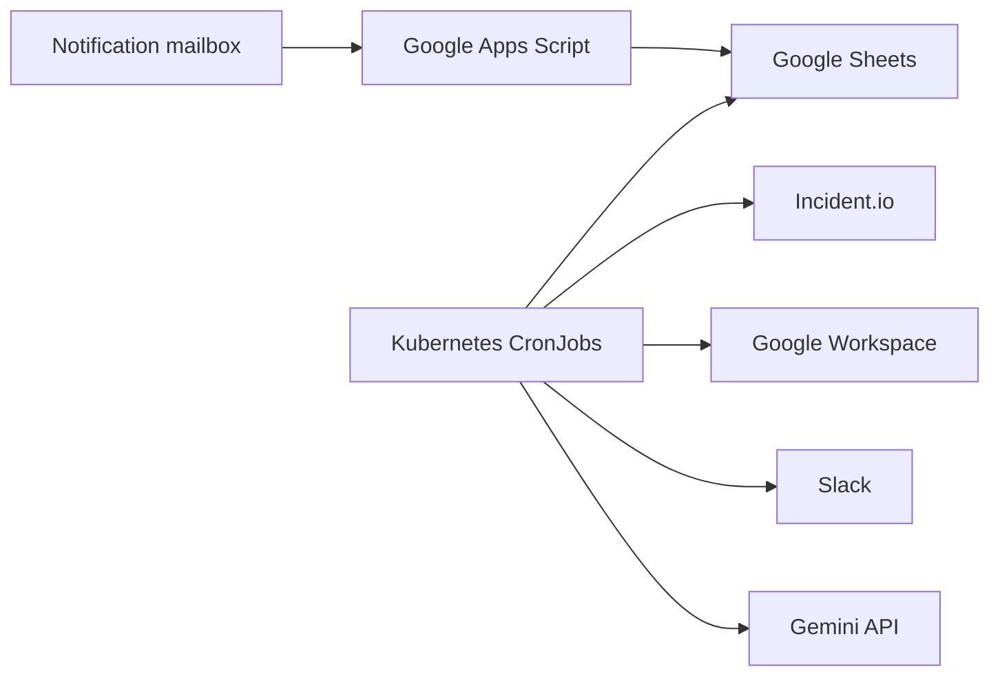

# Opslink

Opslink synchronizes an on-call group across Incident.io, Google Workspace and Slack. It can also publish alert summaries, the upcoming rotation and an optional cloud-operations digest.

The project is written in Go and runs as independent Kubernetes CronJobs. Every command supports `--dry-run` for validation without changing groups or posting messages.

## Commands

| Command | Purpose |
|---|---|
| `updateOncall` | Synchronize the current shift with Google Workspace and Slack |
| `dailyAlerts` | Publish a summary of firing Incident.io alerts |
| `nextOncall` | Publish the next seven days of the on-call schedule |
| `weeklyGcp` | Summarize cloud notices stored in Google Sheets with Gemini |

## Architecture



The optional Apps Script in `scripts/gmail-digest.gs` writes selected notification emails to a spreadsheet. Opslink reads the spreadsheet; it does not access Gmail directly.


## Configuration

Copy `.env.example` to `.env`. Provide credentials through environment variables or a secret manager; never commit `.env`, service-account files, API keys, Slack tokens or schedule IDs.

- Google Workspace: `GOOGLE_APPLICATION_CREDENTIALS`, `GOOGLE_SUBJECT_EMAIL`, `GOOGLE_GROUP_KEY`.
- Slack: `SLACK_BOT_TOKEN`, `SLACK_CHANNEL_ID_OPERATION`, `SLACK_GROUP_ID_UPDATE_ONCALL`.
- Incident.io: `INCIDENT_API_KEY`, schedule IDs and alert filters.
- Weekly digest: `GEMINI_API_KEY`, `GCP_EMAIL_SHEET_ID` and `GCP_EMAIL_SHEET_RANGE`.

All domains, IDs and image names in this repository are placeholders.

## Local validation

```bash
go test ./...
go vet ./...

go run main.go updateOncall --dry-run
go run main.go dailyAlerts --dry-run
go run main.go nextOncall --dry-run
go run main.go weeklyGcp --dry-run
```

## Container

```bash
docker build -t opslink:dev .
```

## Helm

The chart renders only CronJobs. Jobs are configured as a list in `charts/opslink/values.yaml`; disable or remove entries you do not need.

```bash
helm lint charts/opslink
helm template opslink charts/opslink --namespace opslink
helm upgrade --install opslink charts/opslink --namespace opslink --create-namespace \
  --set image.repository=ghcr.io/your-org/opslink \
  --set image.tag=v1.0.0 \
  --set secretName=opslink-secret
```

The chart does not create credentials. Create the configured Secret outside Git and review schedules, resource limits and time zone behavior before deployment.

## Security

Use least-privilege credentials, validate with `--dry-run` and treat alert titles, schedules and generated summaries as sensitive operational data. See [SECURITY.md](SECURITY.md).

## License

Apache-2.0. See [LICENSE](LICENSE).
